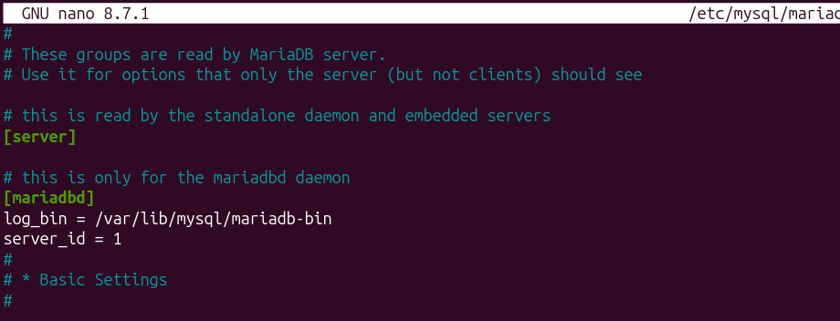

# Tecnológico Nacional de México
## Instituto Tecnológico de Milpa Alta II
### SISTEMAS COMPUTACIONALES

#### Fundamentos Ingenieria de Software
#### Profesor Diego Alberto Bollas Paredes 

##### alumno Cruz Duran Jorge Isaac
##### NC: 241190049
---
# Recuperacion de una base de datos en Mariadb

## Introducción
## Creacion de la base de datos
Empesamos creando nuestra area de trabajo que sera la practica 1
```
mkdir practica 1 
```


entramos a mariadb y creamos nuestra base de datos y nos metemos a ella

```sql
CREATE DATABASE tienda;
USE tienda;
```


creamos nuestra tabla clientes con sus respectivos campos id nombre email

```sql
CREATE TABLE clientes (
);
```


insertamos datos con la siguiente estructura

```sql
INSERT INTO nombre_tabla (campos) VALUES (datos)
```


comprobamos que esten nuestros datos con el comando

```sql
SELECT COUNT(*) FROM clientes;
```


salimos de sql

---

## Respaldo

Ejecutamos el comando para crear una copia de seguridad de la base de datos tienda yque se guarde en el archivo tienda_backup.sql.

seguido de ls que nos mostrara la lista de los archivos dentro de la carpeta 

```
sudo mariadb-dump --databases tienda > tienda_backup.sql
ls -lh tienda_backup.sql
```


---

## Simular desastre
dentro de mariadb borraremos nuestra base de datos tienda ademas que verificaremos que no exista

```sql
DROP nombre_de_la_base;
SHOW DATABASES;
```


---

## Restaurar el respaldo


```
sudo mariadb < tienda_backup.sql
```
Este comando de redireccion mandara al  archivo que contiene la copia de seguridad de la base de datos.


---

## Verificar la recuperación

```
sudo mariadb -e "SELECT * FROM tienda.clientes;"
```
este comando permite permite ejecutar una instrucción SQL directamente desde la terminal, sin necesidad de entrar al entorno interactivo de mariadb
ejecutara la tienda que es la base de datos clientes que es la tabla 


nos muestra nuestros datos sin la necesidad de entrar a mariadb

## Recuperar datos posteriores al respaldo con el binlog


```
sudo nano /etc/mysql/mariadb.conf.d/50-server.cnf
```
con este comando nano modifica el archivo 50-server.cnf 
en este archivo modificaremos la sigiente linea debajo de mariadb


esto es lo que pondremos dentro de ese archivo
```
log_bin = /var/lib/mysql/mariadb-bin
server_id = 1
```


guardamos con Ctrl+ O y salimos Ctrl+Z  reiniciamos el servidor con 
```
sudo systemctl restart mariadb
```


y finalmete verificamos
```
sudo mariadb -e "SHOW VARIABLES LIKE 'log_bin';"
```


## Hacer un respaldo que guarde la posición del binlog
Este comando realiza un respaldo y guarda la información del archivo y la posición del binlog para poder recuperar los cambios posteriores.
```
sudo mariadb-dump --databases tienda --flush-logs --master-data=2 > tienda_pitr.sql
```


con el siguiente comando buscamos la posición guardada debemos guardar estas 2 el bin donde se guarda y la pos
```
grep "CHANGE MASTER" tienda_pitr.sql
```

## Agregamos datos nuevos

dentro de mariadb entramos a nuestra base de datos y agregamos nuevos datos  

```sql
USE TIENDA;
INSERT INTO clientes (nombre, email) VALUES
('Pedro Nunez', 'pedro@correo.com'),
('Laura Vega', 'laura@correo.com');
```


con el comando para contar los registros que tenemos en clientes observamos nuestros clientes de nuestra tabla
```sql
SELECT COUNT(*) FROM clientes;
```


con el comando de sql nos arrojara la feche y hora los debemos guardar mas adelante lo usaremos fue ejecutado 5 seg despues para tener un tiempo estimado 

```sql
SELECT NOW()
```


---

## simulamos el error
borraremos accidentalmente nuestra tabla suponiendo q fue accidental para poder recuperarla mas adelante 
```sql
DELETE FROM nombre de la tabla;
```


observamos que nuestro registro esta en 0 ya que no contiene datos


## Restauramos el respaldo

```
sudo mariadb < tienda_pitr.sql
```
con este comando recuperamos los clientes originales, pero todavía no se actualiza con los que metimos


## Aplicamos el binlog 

```
sudo mariadb-binlog --start-position=330 --stop-datetime="2026-11-26 14:31:20" /var/lib/mysql/mariadb-bin.000002 | sudo mariadb
```
ete comando nos sirve para reproducir los eventos registrados en el archivo binario de mariabd en una fecha y hora determinada que hace rato obtubimos

Se utiliza principalmente para realizar una recuperación de una base de datos a un punto específico en el tiempo 


---

## Verificamos
```
sudo mariadb -e "SELECT * FROM tienda.clientes;"
```

con el comando sin entrar a mariadb e indicando la base de datos y la tabla para ver el contenido de esta observamos que estan nuestro 7 registros


 
## Cuestionario
1. ¿Qué datos se habrían perdido si solo hubieras usado el respaldo de la Parte A?
    
    Nose abrian guardado los 2 registros que hicimos posteriores al respaldo ya que este solo contenia los otros 5 que habiamos creado antes de borrar la base de datos


2. ¿Para qué sirve la opción --master-data=2?
    
    Guarda en el archivo la posicion del binglog clave para PITR 

3. ¿Por qué es necesario activar el binlog antes de que ocurra el error?
    
    Porque el binlog es el queregistra las operaciones realizadas en las bases de datos. Si no está activado no habria un registro de los cambios en el respaldo y no los recuperariamos

4. ¿Por qué se esperaron 5 segundos antes y después de anotar la hora?
    para saber aproximadamente la hora enque se produjo el error

## Conclusión

las bases de datos tambien pueden sufrir percanses la buena administracion nos ayuda a poder recuperar la informacion de manera eficiente como por ejemplo, ante una eliminación accidental, provocada por un mal manejo o incluso de manera intencional, podemos recuperar nuestros datos mediante respaldos y herramientas como el binlog. con esta práctica comprendí la importancia de realizar una copia de seguridad y mantener activado el binlog, ya que este es el que permite recuperar información y evitar pérdida de informacion en un entorno real la auditoria de este puede salvarnos de una perdida de registros dinero etc.

## herramientas deconosidas
- **RPO** (Recovery Point Objective): cuántos datos puedo permitirme perder.
- **RTO** (Recovery Time Objective): cuánto tiempo puedo estar caído.
- **Regla 3-2-1:** 3 copias, en 2 tipos de medios distintos, 1 fuera del sitio.
- **Probar las restauraciones periódicamente:** un backup no probado no es confiable.
- mariadb-dump: Es una herramienta que permite crear copias de seguridad de una base de datos, guardando su estructura y todos sus datos.
- mariadb-binlog: Es una herramienta que permite revisar los registros de cambios realizados en una base de datos y recuperar información.
- Undo log: Permite deshacer los cambios de una transacción que no fue confirmada.
- Binary log (binlog): Es un registro que almacena los cambios realizados en la base de datos, como inserciones, modificaciones y eliminaciones.
- CHECK TABLE: Es un comando que permite revisar si una tabla se encuentra en buen estado y comprobar su integridad.
- PITR: Significa recuperación a un punto en el tiempo. Permite recuperar una base de datos hasta una fecha u hora específica utilizando respaldos y registros binarios